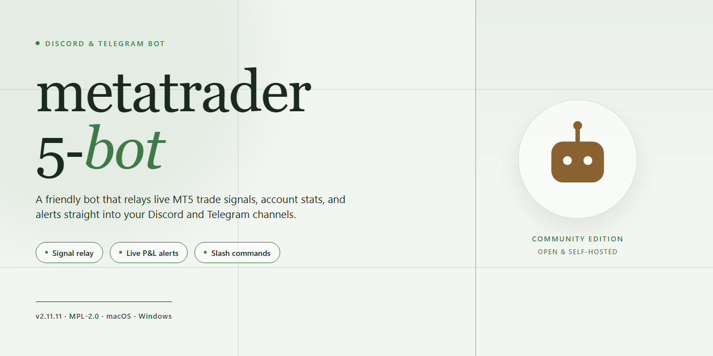

# 🤖 Community-Driven MetaTrader 5 Bot for Discord & Telegram

### 💻 PowerShell Installer

  

---

Hey there, and thanks for stopping by the metatrader-5-bot project — we're glad you found us! This bot is built by and for a community of traders and tinkerers who want a full working installer with every feature activated right out of the box, so you can get up and running on your desktop without hunting down extra pieces. Whether you're automating strategies, poking at the internals, or just exploring what's possible, there's plenty here to dig into. Pull up a chair, check out the docs, and don't be shy about jumping into the conversation — contributions and feedback are always welcome.

## 📋 System Requirements

- Windows 10 or Windows 11
- PowerShell 5.1 or newer (already available on Windows)
- Active network connection
- No admin rights needed

## Features

- **Everything unlocked from the start** — every feature ships active in this build, so there's no tinkering with config files or waiting on activation keys before you can trade, test, or just poke around.

- **Guided desktop installer** — a full, working setup that walks you through the whole thing on Windows x64. Pick your folder, click through, done. No dependency hunting, no package managers, no terminal gymnastics.

- **Ready for immediate use** — the build lands pre-configured and ready to go the moment installation finishes. Launch it, connect, and you're in.

- **Discord and Telegram friendly** — designed to slot into a community workflow. Share signals, coordinate with your group, and keep everyone in the loop whether they live in a Discord server or a Telegram chat.

- **Built for testing and deployment** — equally at home in a sandbox and on a live desktop. Run strategies against your own setups, validate behavior, then deploy with confidence.

- **Offline-capable** — no phoning home required. The installer and build work in isolated environments, so air-gapped setups and locked-down machines are fair game.

- **Community-driven by design** — the project grows from feedback, bug reports, and feature requests from the people actually using it. Got an idea? The community is where it starts.

- **Lightweight footprint on your workflow** — a standalone build means no global installs, no system-wide changes, and no leftover cruft. Uninstall is as clean as install.

- **Actively maintained** — regular updates keep the build in sync with the latest platform behavior, so you're not stuck running something stale six months down the line.

## Commands

Welcome to the command center! Everything below is designed to be typed right into your chat window — whether you're on Discord or Telegram — so you can drive the full Metatrader 5 Bot experience without ever leaving the conversation. The command set is intentionally generous: every feature in the activated build has a matching command, and the whole thing is built to be explored, remixed, and shared with your community.

Drop the prefix in front of any command to get going. If you ever forget the syntax, just ask the bot for its command list and it will happily lay everything out for you.

---

### 🚀 Getting Started Commands

- **start** — Wake the bot up and receive a friendly welcome with a quick tour of what it can do. Great first step for new community members.
- **help** — Pull up the full command reference, grouped by category, with short descriptions of each option.
- **status** — Check the bot's current health, uptime, and which feature modules are active in this build.
- **ping** — A lightweight round-trip check to confirm the bot is responding and measure latency.
- **version** — Show the build identifier and feature-set level so you always know what you're running.

### 📊 Market & Analysis Commands

- **quote** — Request the latest price snapshot for a symbol you specify.
- **chart** — Generate a quick visual summary of recent price action for a chosen instrument.
- **analyze** — Run the built-in analysis routine over a symbol and return a concise breakdown of the current setup.
- **signals** — Toggle or review the signal feed that the bot broadcasts to your channel.
- **history** — Retrieve a rolling log of recent market events and bot-detected opportunities.

### 🤖 Automation & Strategy Commands

- **strategy list** — Browse every strategy template bundled with this build.
- **strategy enable** — Activate a specific strategy so the bot begins tracking it.
- **strategy disable** — Pause a strategy without deleting its configuration.
- **backtest** — Kick off a quick simulation over historical data for a selected strategy.
- **schedule** — Set recurring windows during which the bot should run its routines.
- **watchlist add** / **watchlist remove** — Curate the symbols your community cares about most.
- **watchlist show** — Display the current watchlist in a tidy summary.

### ⚙️ Configuration Commands

- **config show** — Dump the active configuration so you can see exactly how the bot is tuned.
- **config set** — Adjust a single setting on the fly, with validation feedback if something looks off.
- **config reset** — Restore defaults for one key or the entire configuration block.
- **prefix** — Change the command prefix your server uses, so it plays nicely alongside other bots.
- **language** — Switch the bot's reply language for a more welcoming experience across your community.
- **notify** — Choose which event types should trigger a ping in your channel.

### 👥 Community & Moderation Commands

- **role add** / **role remove** — Grant or revoke access to bot features for specific community roles.
- **permissions** — Review who can run which commands at a glance.
- **invite** — Generate a shareable invitation so friends can bring the bot into their own space.
- **feedback** — Send a note straight to the maintainers; bug reports, ideas, and praise all welcome.
- **stats** — See community-wide usage numbers: command counts, active members, and popular features.

### 🧩 Utility & Fun Commands

- **remind** — Set a lightweight reminder that the bot will surface later in the channel.
- **poll** — Spin up a quick community poll with reaction-based voting.
- **calc** — Do fast position-size and risk math without opening a separate tool.
- **convert** — Convert between units, currencies, and timeframes on the spot.
- **roll** — A tiny bit of randomness for community games and giveaways.

### 🛡️ Admin Commands

- **reload** — Refresh the bot's modules after a configuration change.
- **broadcast** — Push an announcement to every channel the bot is connected to.
- **audit** — Review a chronological log of administrative actions.
- **shutdown** — Gracefully stop the bot's automation loops while keeping the connection alive.

---

Every command returns a clear, human-readable response — and if you get the syntax slightly wrong, the bot will nudge you in the right direction instead of staying silent. The command set grows with the community, so if there's something you wish existed, the **feedback** command is the fastest way to make it happen. Happy exploring!

## Configuration

Getting your bot dialed in is where the fun really begins — and the good news is that metatrader-5-bot ships with every feature already activated, so you can go from first launch to a fully personalized setup in just a few minutes. Everything below lives in the local configuration files that come with your build; no accounts to create, no activation hoops to jump through. Just open, tweak, and trade.

### 🔑 Where Everything Lives

All settings are stored in plain, human-readable config files inside the bot's main folder. You'll find separate files for the Discord and Telegram sides of the bot, plus a shared core config for global behavior. Edit them with any text editor, save, and restart the bot — changes apply instantly. We deliberately kept the format simple so community members can share snippets, fork setups, and help each other without a steep learning curve.

### 🤖 Discord Configuration

- **Bot Token & Prefix:** Drop in your bot token and pick a command prefix that feels natural to your server.
- **Guild & Channel Bindings:** Route alerts, trade signals, and reports to specific servers and channels — or let the bot listen everywhere.
- **Role Permissions:** Decide who can trigger commands, view performance stats, or adjust live settings. Great for team servers where not everyone should have the keys.
- **Embed Styling:** Tweak colors, thumbnails, and footer text so notifications match your server's vibe.

### ✈️ Telegram Configuration

- **API Token & Chat IDs:** Connect your bot and whitelist the chats, groups, or channels it should talk to.
- **Notification Rules:** Choose which events ping you — new positions, closed trades, drawdown warnings, or daily summaries.
- **Command Access:** Mirror your Discord permission logic or set a separate allowlist for Telegram users.
- **Message Formatting:** Keep it compact for mobile or rich with detail for desktop — your call.

### ⚙️ Core Trading & Global Settings

- **Account & Symbol Preferences:** Point the bot at your terminal, choose default symbols, and set your preferred lot sizing behavior.
- **Risk Controls:** Daily loss caps, max open positions, and cooldown timers — all configurable so the bot respects your boundaries.
- **Signal & Strategy Toggles:** Every feature is unlocked out of the box; flip individual strategies on or off to match your style.
- **Logging & Reporting:** Set verbosity levels and choose where summaries get written so you always know what the bot did and why.

### 🧩 Community Presets

Because this project thrives on shared knowledge, config presets are a first-class feature. Export your setup as a single file, hand it to a friend, and they can import it in seconds. Many community members maintain tuned presets for different market conditions — swap them in, compare results, and contribute your own back to the pool.

### 💡 Pro Tips for Smooth Configuring

- Back up your config folder before big changes — a quick copy-paste saves headaches.
- Change one thing at a time and watch the logs; it makes troubleshooting painless.
- Keep tokens and chat IDs private. Treat config files like passwords when sharing screenshots.
- If a setting isn't taking effect, double-check you restarted the bot after saving.

That's it — no hidden gates, no paywalled settings. The full feature set is yours from the moment you open that config folder. Happy tuning, and welcome to the community!

## FAQ

**Is this bot really ready to use right after the installer finishes?**
Yes — that's the whole point. The build ships with every feature already activated, so there's no key hunting, no separate activation step, and no "pro" tier locked behind a paywall. Install it, launch it, and the full feature set is available on your desktop right away.

**Which platforms does it work on?**
The installer targets Windows x64 desktop environments. If you're running a modern 64-bit Windows machine, you're covered. Community members have reported smooth runs on both dedicated trading rigs and everyday laptops.

**Do I need to configure anything before the bot is useful?**
Not strictly — the defaults are sane and the bot will start up functional out of the box. That said, the Configuration section covers the knobs worth tuning (symbols, risk parameters, notification preferences) if you want to tailor behavior to your workflow. Most people start with defaults, then adjust after a day or two of observation.

**Can I run it alongside my existing Discord or Telegram setup?**
Absolutely. The bot integrates with both platforms, so you can route alerts and commands wherever your community already lives. Many users run Discord for team coordination and Telegram for personal mobile alerts — the bot doesn't force you to pick one.

**How do I know which commands are available?**
The Commands section lists everything, but the short version: the bot exposes a friendly command surface for status checks, trade queries, and configuration tweaks. Type the help command in your connected channel and it'll walk you through the rest interactively.

**What if a feature seems missing or an update breaks something?**
First, double-check you're on the latest distributed build — older copies can lag behind on features. If something still looks off, the community is the fastest path to answers. Bug reports, feature requests, and "am I holding it wrong?" questions are all welcome; the project grows through exactly that kind of feedback.

**Is this a one-person project or something bigger?**
It's community-driven at heart. Contributions, suggestions, and shared configurations from users shape what gets prioritized. If you've built a useful setup or spotted a rough edge, sharing it back helps everyone — and it's genuinely appreciated.

**Where do I go if I'm stuck?**
The Support section points to the right channels. Before posting, a quick skim of the Configuration and Commands sections solves most confusion — but if not, ask away. No question is too basic, and someone in the community has almost certainly hit the same thing.

**Can I customize or extend the bot?**
Yes. The configuration layer is designed to be approachable, and the feature set is broad enough that most workflows fit without modification. Power users regularly share tweaks and setups that others adopt — so if you push it somewhere interesting, consider sharing it back.

## Support

Need a hand, a second pair of eyes, or just want to swap strategies with people running the same setup? You're in the right place — this project grows through the community around it, and there's a spot for everyone, whether you're on day one or deep into custom configurations.

**Ways to get involved:**

- 💬 **Chat with the community** — hop into the Discord or Telegram space to ask quick questions, share what's working, and trade tips with other users of metatrader-5-bot.
- 🐞 **Report a bug** — found something acting up? Open an issue with your OS version, the steps that led to the problem, and any error text you saw. Clear repro steps get fixes faster.
- 💡 **Suggest a feature** — got an idea that would make the bot more useful? Feature requests are genuinely welcome, and popular ones shape where the project goes next.
- 🧩 **Share a configuration** — built a setup you're proud of? Post it so others can learn from it and build on top of it.
- 📚 **Improve the docs** — spotted a confusing step or a missing detail in the README or FAQ? Doc fixes count as contributions too.
- 🤝 **Help others** — the friendliest thing you can do is answer a question from someone a few steps behind you.

**Before you post, a quick checklist:**

1. Skim the **FAQ** and **Configuration** sections above — a lot of common questions are already answered there.
2. Search existing discussions and issues so we don't split the same conversation across threads.
3. When reporting, include your platform, the version you're running, and what you expected versus what actually happened.

**Community guidelines, short version:** be kind, be patient, stay on topic, and assume good faith. Beginners are welcome here — everyone started somewhere. Keep support requests in the designated channels so they don't get lost, and avoid posting the same question in multiple places.

Every question answered and every issue filed makes metatrader-5-bot better for the next person. Thanks for being part of it — see you in the channels! 🚀

## License

This project is shared in the spirit of the open-source and trading-automation community: friendly, collaborative, and built to grow with the people who use it. The goal is simple — keep the bot feature-rich, easy to run on a desktop, and welcoming for everyone from curious first-timers to seasoned strategy tinkerers.

You are free to use, study, modify, and share this project however you like, including in your own personal or community builds. If you improve it, add a feature, or fix a bug, sharing those changes back with the community is warmly encouraged — every small contribution makes the bot better for the next person. Just remember to keep the original credits intact, and be respectful of the effort that went into making it work.

The software is provided "as is," without warranty of any kind. Trading carries real risk, so test thoroughly, use sensible risk management, and treat this tool as a helper, not a guarantee. The maintainers and contributors are not responsible for financial losses, missed trades, or any other damages that may arise from using it.

Let's keep building something genuinely useful together — enjoy the bot, and happy automating!